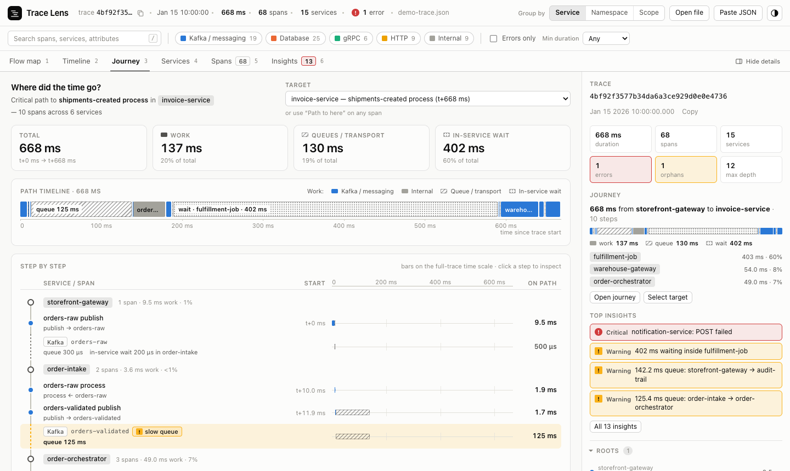
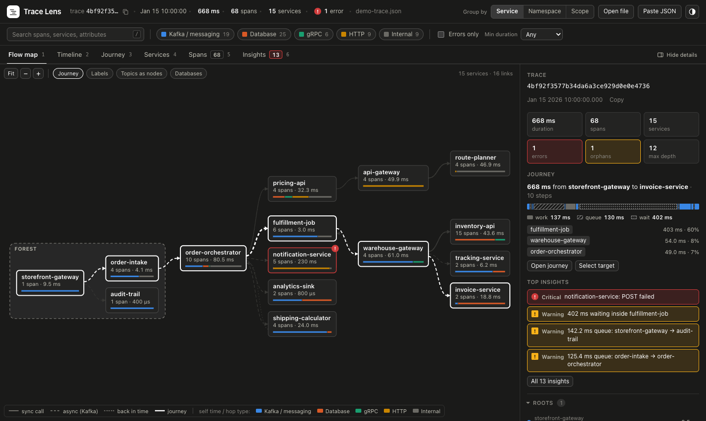
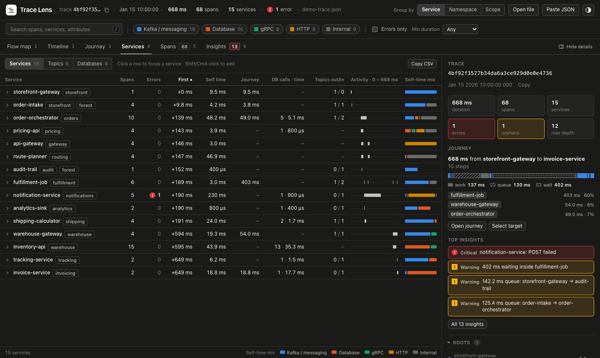
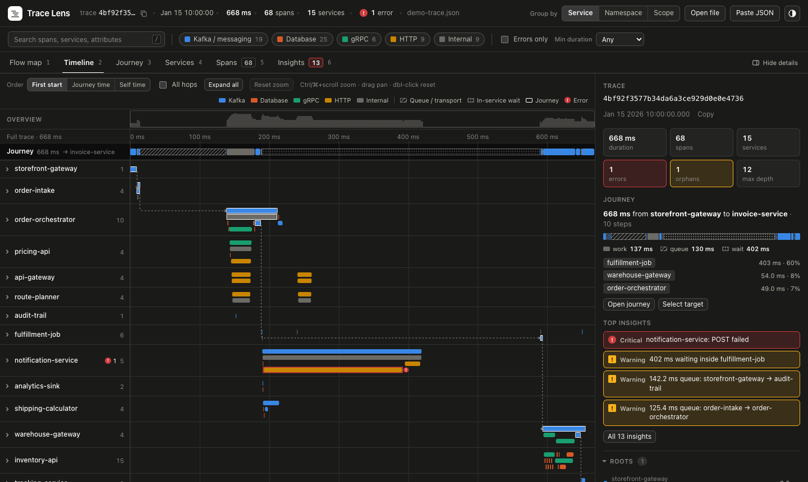
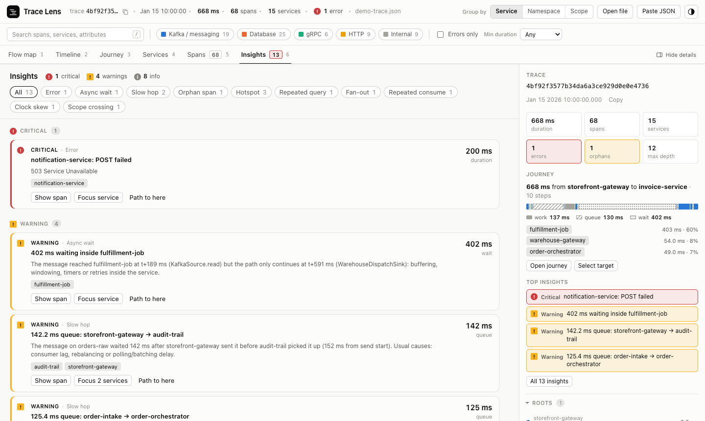

# Trace Lens

Explore a distributed trace **grouped by service**: who called whom, where the time went, and what looks wrong.
Load an OpenTelemetry trace exported from Grafana Tempo (or Jaeger) and get a flow map, swimlanes per service,
the critical path broken down into work / queue / wait, and auto-detected insights.

It is a static, zero-dependency web page. Traces are parsed in your browser and never leave it.



## Run it

### Option 1: open the file (no install)

```bash
git clone https://github.com/gabrielclimb/trace-lens.git
cd trace-lens
open index.html        # or double-click it; works from file://
```

### Option 2: Docker

```bash
docker run --rm -p 8080:8080 ghcr.io/gabrielclimb/trace-lens:latest
```

Then open <http://localhost:8080>. The image is nginx (unprivileged, port 8080) serving the static files.
Multi-arch: `linux/amd64` and `linux/arm64`.

### Option 3: any static server

```bash
make serve             # python3 -m http.server 8080
```

## Load a trace

The app opens with a fictional demo trace. To look at your own:

1. In Grafana: **Explore → Tempo** → open a trace → **Download → JSON** (OTLP).
2. Drag the file onto the page, click **Open file**, or paste the JSON (**Paste JSON** / Cmd+V).

Supported inputs: Tempo/Grafana OTLP JSON (`batches` or `resourceSpans`, `instrumentationLibrarySpans` or
`scopeSpans`, hex or base64 ids, numeric or string timestamps) and Jaeger JSON. Files with several traces get a
trace picker.

### Auto-load your own trace

```bash
make local-trace TRACE=~/Downloads/my-trace.json   # writes data/local-trace.js (gitignored)
```

With Docker, mount it over the placeholder:

```bash
{ printf 'window.TV_LOCAL_TRACE = '; cat my-trace.json; printf ';'; } > local-trace.js
docker run --rm -p 8080:8080 \
  -v "$PWD/local-trace.js:/usr/share/nginx/html/data/local-trace.js:ro" \
  ghcr.io/gabrielclimb/trace-lens:latest
```

## What you get

| View | What it shows |
|---|---|
| **Flow map** | Service graph in causal order, left to right. Dashed edges are async (Kafka), solid are sync (gRPC/HTTP). Optional topic and database nodes, journey overlay, deploy-scope boundary. |
| **Timeline** | One swimlane per service, critical path pinned on top, hop connectors, zoom/pan, overview brush. |
| **Journey** | The critical path to any span ("Path to here"), split into **work**, **queue / transport** (time between a producer and the first delivery) and **in-service wait** (e.g. a Flink job holding a message). |
| **Services** | Sortable table per service (self time, journey time, DB calls, topics in/out, activity strip), plus **Topics** and **Databases** tables and CSV export. |
| **Spans** | Classic waterfall tree with service-boundary badges (`→ Kafka 12.8 ms`) and a "Collapse by service" mode. |
| **Insights** | Errors, slow queues, long in-service waits, missing parent spans (with a likely-caller guess), repeated queries (N+1), duplicate consumption, fan-out, clock skew, deploy-scope crossings, hotspots. |

**Group by** switches the grouping between `service.name`, Kubernetes namespace and deployment scope.
Colors always mean span category (Kafka, database, gRPC, HTTP, internal), never a service.

| Flow map | Services |
|---|---|
|  |  |
| **Timeline** | **Insights** |
|  |  |

Keyboard: `1`–`6` switch views, `/` search, `Esc` clear selection, `[` / `]` previous/next span.

## Development

No build step: plain JavaScript files under a global `TV` namespace so the page also works from `file://`.

```
index.html, css/, js/app.js       shell (header, filters, tabs, side panel)
js/core/                          parse.js → model.js (groups, hops, journey, insights) → store.js
js/views/                         one file per view
dev/harness.html?view=<id>        mount a single view against the demo trace
data/sample-trace.{json,js}       fictional demo trace (tests/make_demo_trace.py)
SPEC.md                           the data model and view contract
```

```bash
make test       # generate fixtures, run core tests, cross-check against an independent Python oracle
make demo       # regenerate the demo trace
make docker-build docker-run
```

Tests need Node 20+ and Python 3. The Python oracle (`tests/oracle.py`) re-implements the model from
`SPEC.md` independently; `tests/compare.js` diffs both on every fixture (OTLP variants, Jaeger, multi-trace,
an error-heavy trace and a 5,000-span synthetic trace).

## Publishing

Every push to `main` runs the tests and publishes `ghcr.io/gabrielclimb/trace-lens:latest` (and `:sha-…`) via
GitHub Actions. Tags `v*` also publish `:<version>`.
